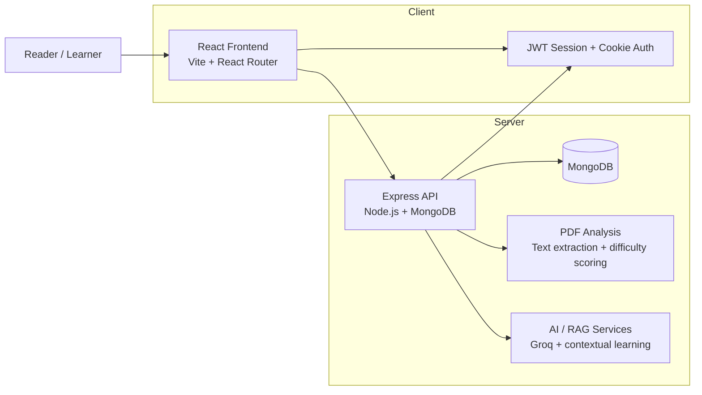
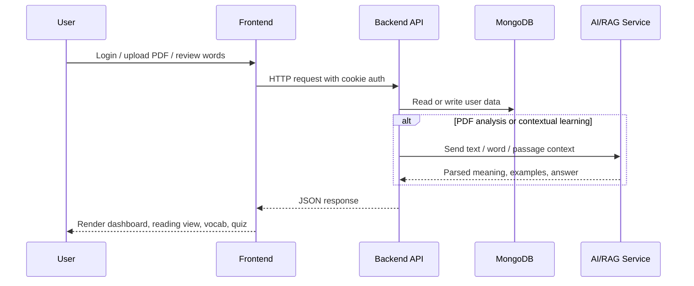

# WordKnit

WordKnit is a full-stack vocabulary learning platform built for readers who want to learn real words from the material they read. Users can upload PDFs, read highlighted passages in-app, save difficult words, review them with flashcards and quizzes, and practice speaking in context.

The project combines a React + Vite frontend, a Node.js/Express API, MongoDB persistence, and AI-powered language-learning workflows.

## Product overview

WordKnit turns reading into a learning system:

- upload or analyze a PDF
- extract difficult words from a document
- show contextual meanings and examples
- save vocabulary to a personal learning library
- review through quiz and flashcard experiences
- practice speaking and comprehension via AI-assisted flows

## Architecture



## High-level request flow



## Key features

- PDF reading and analysis for difficult vocabulary
- Document-based vocabulary extraction and tracking
- Word profile pages with context and definitions
- Quizzes and flashcards
- Speaking practice and AI-assisted learning flows
- JWT-based authenticated sessions using cookies
- MongoDB persistence for users, words, documents, bookmarks, and speaking sessions
- Dockerized local development setup

## Tech stack

- Frontend: React 19, Vite, React Router, Axios
- UI: Radix components, custom styles, responsive layout
- Backend: Node.js, Express 5, MongoDB via Mongoose
- Auth: JWT + bcryptjs + httpOnly cookies
- AI/ML: Python services, Groq integration, document-context analysis
- Deployment: Vercel, Docker Compose

## Repository structure

```text
WordKnit/
├── backend/
│   ├── config/
│   ├── controllers/
│   ├── middleware/
│   ├── models/
│   ├── routes/
│   ├── services/
│   ├── tests/
│   ├── utils/
│   ├── validators/
│   ├── server.js
│   ├── package.json
│   ├── requirements.txt
│   ├── pdf_service.py
│   ├── ocr_service.py
│   ├── Dockerfile
│   └── vercel.json
├── frontend/
│   ├── public/
│   ├── src/
│   ├── package.json
│   ├── vite.config.js
│   ├── Dockerfile
│   ├── nginx.conf
│   └── README.md
├── docs/
│   ├── ARCHITECTURE.md
│   └── DEVELOPMENT.md
├── docker-compose.yml
├── DOCKER.md
├── README.md
├── .gitignore
└── .github/
```

## Documentation

- [Architecture guide](./docs/ARCHITECTURE.md)
- [Development guide](./docs/DEVELOPMENT.md)
- [Docker guide](./DOCKER.md)

## Getting started

### Prerequisites

- Node.js 18+
- Python 3.10+
- MongoDB Atlas or local MongoDB
- Groq API key for AI features

### 1) Clone and install

```bash
git clone https://github.com/Mariam-gitt/WordKnit.git
cd WordKnit
```

Backend:

```bash
cd backend
npm install
pip install -r requirements.txt
```

Frontend:

```bash
cd ../frontend
npm install
```

### 2) Configure environment variables

Create a `.env` file in `backend/`:

```env
MONGO_URI=your_mongodb_connection_string
JWT_SECRET=your_secret_key
GROQ_API_KEY=your_groq_api_key
PORT=5000
FRONTEND_URL=http://localhost:5173
```

Create a `.env` file in `frontend/` if needed for local development:

```env
VITE_API_URL=http://localhost:5000/api
```

### 3) Run locally

Backend:

```bash
cd backend
npm run dev
```

Frontend:

```bash
cd frontend
npm run dev
```

Then open:

- Frontend: http://localhost:5173
- Backend: http://localhost:5000

### 4) Run with Docker

From the project root:

```bash
docker-compose up --build
```

## API areas

The backend exposes major route groups for:

- `POST /api/auth/*` — registration, login, account flows
- `GET /api/words`, `POST /api/words` — vocabulary management
- `POST /api/pdf/*` — document and PDF processing
- `GET /api/documents`, `POST /api/documents` — file and document records
- `GET /api/bookmarks`, `POST /api/bookmarks` — saved reading locations
- `GET /api/profile/*` — word profile and contextual lookup
- `POST /api/contextual/*` — AI contextual interpretation
- `POST /api/speaking/*` — speaking-practice conversation flow

## Data model

The data layer is centered on MongoDB documents such as:

- `User`
- `Word`
- `Document`
- `Bookmark`
- `SpeakingSession`
- `WordCache`

These models support user-specific learning history, vocabulary retention, and reading flows.

## Security and app behavior

- passwords are hashed before storage
- JWT-based auth is handled via secure cookies
- protected routes are enforced by middleware
- CORS and origin validation are configured for frontend-specific access
- API rate limiting is applied to paid/AI-heavy endpoints

## Notes

This project has grown beyond a basic dictionary app into a reading-and-learning workflow where vocabulary is learned in the context of documents, practice tasks, and repeated review. The system is designed to make vocabulary retention more effective by connecting reading, memory, and contextual meaning.

## License

This project is distributed under the ISC license as defined in the repository package metadata.

## Author

Mariam

GitHub: https://github.com/Mariam-gitt
