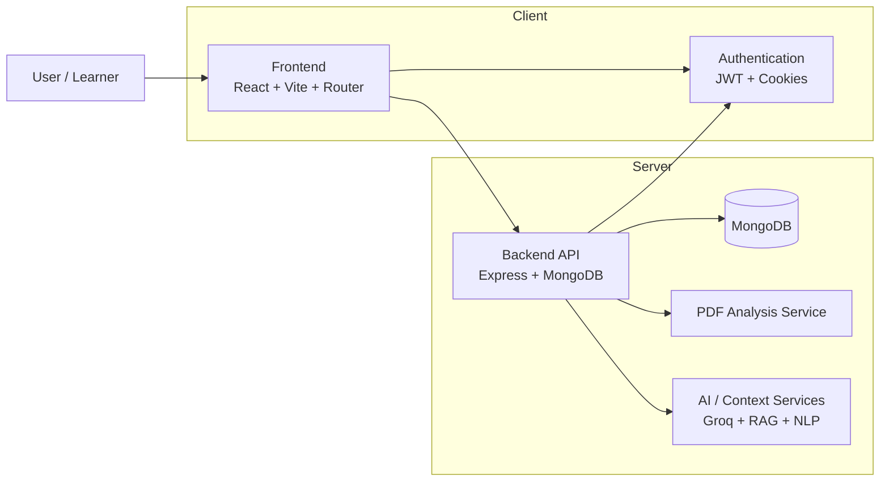
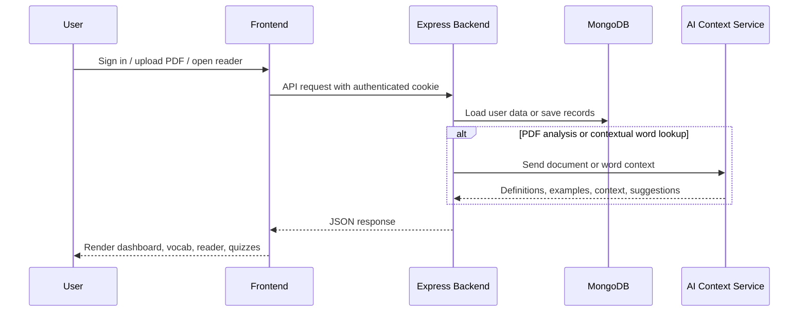
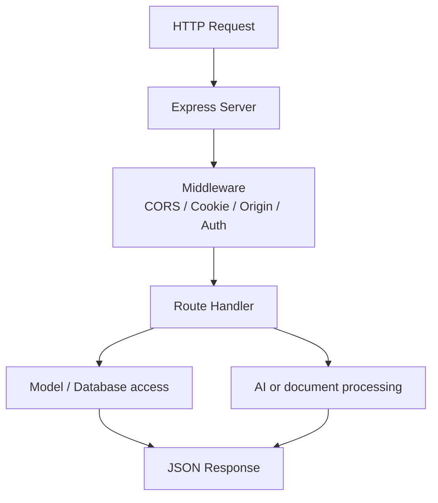
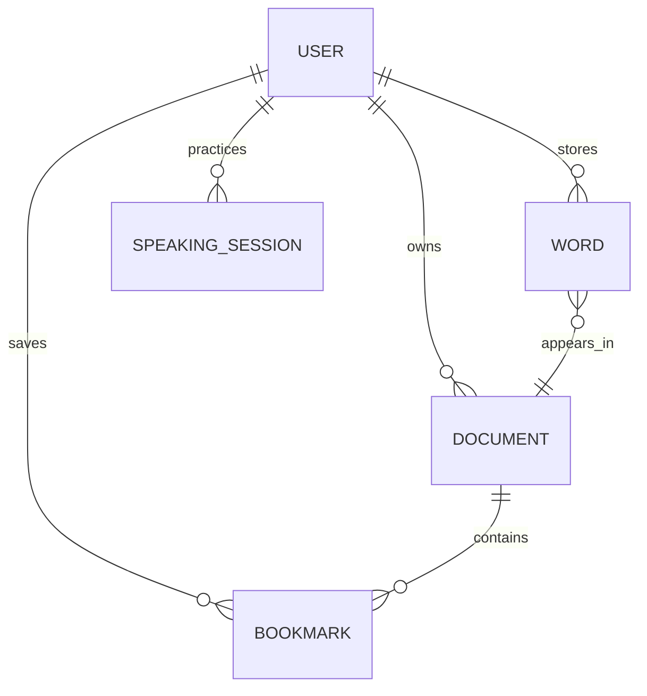
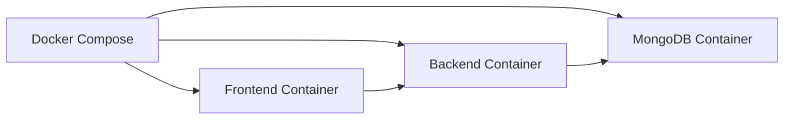

# WordKnit Architecture

This document describes the structure, runtime flow, and core responsibilities of the WordKnit application.

## Overview

WordKnit is a reading-first vocabulary learning system. A user uploads or analyzes reading material, the app identifies difficult or unfamiliar words, saves them into a personal vocabulary system, and supports practice through quizzes, flashcards, and speaking tasks.

The system is built as a full-stack JavaScript application with:

- React frontend for the user experience
- Express API for application logic and data access
- MongoDB for persistence
- Python-based services for document and AI processing
- Docker-based local orchestration

## High-level architecture



## Runtime flow



## Frontend architecture

The frontend is a React application rendered with Vite and client-side routing.

### Main responsibilities

- handle authentication and protected routes
- manage the reading experience
- display the dashboard, vocabulary, quiz, and flashcards
- call the backend API with cookie-based auth
- render word profiles and reading context

### Frontend structure

```text
frontend/
├── public/
├── src/
│   ├── components/
│   ├── pages/
│   ├── styles/
│   ├── App.js
│   ├── AuthContext.jsx
│   ├── api.js
│   ├── index.js
│   ├── navLinks.js
│   └── ...
├── package.json
├── vite.config.js
├── Dockerfile
├── nginx.conf
├── README.md
└── vercel.json
```

### Frontend routing model

The app uses a route-based experience centered around a protected application shell.

Key routes include:

- `/` — login screen
- `/register` — registration
- `/dashboard` — overview and learner workspace
- `/reader` — PDF reading module
- `/vocabulary` — stored words and vocabulary library
- `/flashcards` — flashcard review
- `/quiz` — quiz session
- `/profile/:word` — contextual word detail page
- `/speaking` — speaking practice

Protected routes are checked through an auth context and redirect users to login if they are not authenticated.

## Backend architecture

The backend is an Express application that serves the application API and orchestrates data, business logic, and AI flows.

### Main responsibilities

- enforce CORS and origin restrictions
- connect and manage MongoDB usage
- protect routes with JWT/cookie auth
- process document and PDF metadata
- manage vocabulary, bookmarks, user records, and learning data
- expose AI/contextual endpoints for words and reading analysis
- handle security concerns such as rate limiting and request validation

### Backend structure

```text
backend/
├── config/
├── controllers/
├── middleware/
├── models/
├── routes/
├── services/
├── tests/
├── utils/
├── validators/
├── server.js
├── package.json
├── requirements.txt
├── pdf_service.py
├── ocr_service.py
├── Dockerfile
├── Dockerfile.python
├── Dockerfile.ocr
├── vercel.json
└── ...
```

## API layering model

The backend follows a common route-controller-model pattern.

### Request flow



### Route groups

Major route domains include:

- `api/auth` — login, registration, account operations
- `api/words` — vocabulary records and word management
- `api/documents` — document metadata and lifecycle
- `api/bookmarks` — reading/bookmark persistence
- `api/profile` — word profile lookups and contextual info
- `api/pdf` — PDF extraction and difficulty analysis
- `api/contextual` — AI contextual interpretation
- `api/speaking` — speech/practice workflows

## Data model

WordKnit primarily uses MongoDB collections represented as Mongoose models.

### Core entities

- `User` — account details, preferences, auth state
- `Word` — vocabulary item, meaning, focus, status, context
- `Document` — uploaded PDF, metadata, and reading resource information
- `Bookmark` — saved document position or reading state
- `SpeakingSession` — speech/practice conversation state
- `WordCache` — cached data for faster word processing and retrieval

### Relationship model



## AI and document processing

The project includes both JavaScript and Python-powered processing.

### Python services

- `pdf_service.py` — PDF parsing and text extraction / analysis
- `ocr_service.py` — optional OCR processing for text extraction workflows
- `rag_*` helpers — retrieval and LLM-related support modules

### AI behavior

The AI side is used for:

- contextual interpretation of difficult words
- passage-aware vocabulary explanations
- reading assistance and language-learning feedback
- speaking and conversation-based practice

## Security model

The application uses a layered security model.

### Included protections

- JWT-based session handling
- cookie-based authenticated requests
- CORS enforcement with allowed frontend origins
- origin validation middleware to reduce cross-site abuse
- rate limiting for AI-heavy routes
- protected API endpoints and middleware-based auth checks
- Mongoose-backed persistence and secure config separation

## Deployment architecture

WordKnit supports both local and hosted deployment patterns.

### Local development

- Vite dev server for frontend
- Node dev server for backend
- MongoDB instance for persistent storage
- optional Python services for PDF/AI workflows

### Containerized setup

The project includes Docker Compose configuration to run local services together.



### Production hosting

The repository is configured for cloud-friendly deployment patterns:

- frontend on Vercel
- backend on Vercel or a Node-compatible host
- MongoDB in a managed database service
- AI services through API keys and external integrations

## Design principles

WordKnit is designed around a few core ideas:

1. learning should happen in context, not from isolated word lists
2. reading and vocabulary retention are connected experiences
3. personal study history should persist across sessions
4. AI should support understanding without replacing the learner's agency
5. the app should remain modular enough for growth and experimentation

## Future extension points

The architecture is structured for expansion in several areas:

- additional document formats and OCR support
- more personalized review algorithms
- deeper analytics and learner progress tracking
- adaptive quiz generation
- broader language-learning workflows and study paths

## Summary

WordKnit is a layered full-stack application built around the concept of reading to learn. The frontend provides a modern learner experience, the backend handles persistence and business logic, and AI/document processing enriches the reading experience with contextual vocabulary support.
